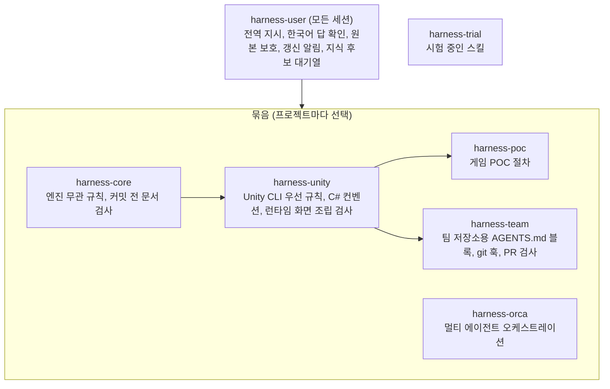
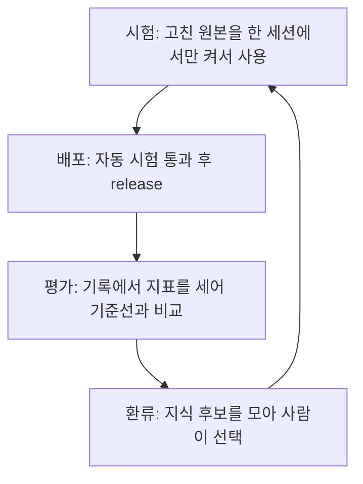

# harness

Claude Code와 Codex용 작업 하네스. 프로젝트에서 에이전트가 따를 규칙, 스킬, 훅, 커밋 전 검사를 플러그인 묶음으로 제공한다.

- 플러그인 7개 (user 1, 묶음 5, 시험 1)
- 스킬 12개 (정식 9, 시험 3)
- 자동 시험 317개
- 설계 결정 기록: [docs/decisions.md](docs/decisions.md)

## 설계 원칙

- 반드시 지켜야 하는 것은 훅과 커밋 전 검사로 강제하고, 판단이 필요한 것만 짧은 규칙으로 둔다
- 규칙은 프로젝트에 복사하지 않는다. 플러그인이 세션 시작 때 주입하므로 원본을 고쳐 배포하면 켠 프로젝트에 모두 반영된다
- 엔진 사용법은 공식 도구를 따르고, 하네스는 그와 다른 점만 담는다
- 효과가 확인되지 않은 스킬은 묶음에 넣지 않고 `trial/`에서 시험한다
- 평가는 에이전트의 자기 보고가 아니라 기록(대화, git, Unity 기록)으로 한다

## 구조



| 플러그인 | 범위 | 내용 |
|---|---|---|
| harness-user | user | 전역 지시 주입, 한국어 답 확인, 원본 수정 확인, 갱신 알림, 지식 후보 대기열 / 스킬: grilling, skill-make, harness-apply, harness-update |
| harness-core | project | 작업 범위, 확인과 보고, 커밋, 문서 규칙 / 커밋 전 문서 검사 |
| harness-unity | project | 공식 Unity CLI 우선 규칙, C# 컨벤션, 런타임 화면 조립 검사 / 스킬: unity-module |
| harness-poc | project | POC 규칙 / 스킬: poc (기획, 승인, 구현, 플레이테스트, 마감) |
| harness-team | local | 팀 저장소에 넣는 AGENTS.md 블록, pre-push, 문서 검사 사본, PR 템플릿 / 스킬: pr-review |
| harness-orca | project | 오케스트레이션 정책 / 스킬: orchestrate, milestone-start |
| harness-trial | local | 시험 중인 스킬: game-art, game-mockup |

### 프로필

프로필은 쌓을 묶음과 문서 수준의 조합이다 (`profiles.json`).

| 프로필 | 묶음 | 문서 수준 | 용도 |
|---|---|---|---|
| `personal` | core | standard | 엔진 없는 프로젝트 |
| `unity-game` | core, unity | standard | Unity 게임 |
| `unity-poc` | core, unity, poc | light | 단기 게임 POC |
| `unity-team` | core, unity, team | standard | 팀 저장소 (PR 관리자용) |

orca는 프로필에 포함하지 않고 필요할 때 더한다 (`--packs core,unity,orca`).

### 프로젝트에 들어가는 것

- 처음 한 번 만드는 파일: AGENTS.md 머리, `docs/` 틀
- 커밋 전 검사 연결: `.githooks/`
- 팀 프로필은 팀원이 플러그인 없이도 적용받도록 규칙 블록과 검사 사본을 저장소 파일로 넣는다

## 개선 사이클



| 단계 | 도구 | 동작 |
|---|---|---|
| 시험 | `claude --plugin-dir <묶음 폴더>` | 설치 없이 현재 세션에서만 플러그인 사용 |
| 배포 | `tests/run.mjs`, `release.mjs` | 시험이 모두 통과하면 원본 지문을 저장. release는 원본이 지문과 다르면 중단 |
| 평가 | `eval/run.py` | 대화 기록, Unity eval 기록, git에서 지표 집계. 판단이 필요한 항목은 후보만 추출 |
| 환류 | `user/hooks/wiki_candidates.py` | 답 끝의 `wiki 후보: <한 줄>`을 로컬 대기열에 수집. 저장소에는 쓰지 않음 |

## 설치

요구 사항: Node.js, Python 3, git, Claude Code CLI. Unity 묶음은 Unity 공식 CLI 필요. Windows 11, Node 24, Python 3.13에서 시험했다.

설치 스크립트는 이 폴더의 부모를 원본 저장소로 보므로 `_harness`라는 이름으로 clone한다.

```bash
git clone https://github.com/minsforgh/harness.git my-notes/_harness
```

시험 실행 (임시 폴더에서만 동작):

```bash
node my-notes/_harness/tests/run.mjs
```

PC 설정 (마켓플레이스 등록, harness-user 설치, Codex 전역 지시 블록). 여러 번 실행해도 결과가 같다:

```bash
node my-notes/_harness/setup.mjs --dry-run
```

```bash
node my-notes/_harness/setup.mjs
```

## 사용

프로젝트 적용 (Claude 세션에서 harness-apply 스킬로도 가능). 커밋은 하지 않는다:

```bash
node my-notes/_harness/apply.mjs <프로젝트 폴더> --profile personal --dry-run
```

```bash
node my-notes/_harness/apply.mjs <새 폴더> --new --profile unity-poc
```

| 옵션 | 동작 |
|---|---|
| `--profile <이름>` | 프로필 선택 |
| `--packs core,unity,orca` | 묶음 직접 지정 |
| `--docs standard\|light` | 문서 수준 변경 |
| `--new` | 폴더 생성, `git init` 후 적용. unity 묶음이면 `unity projects create`로 프로젝트 생성 |
| `--personal` | 다른 사람이 관리하는 저장소. 플러그인만 local 범위로 켜고 공용 파일은 건드리지 않음 |
| `--dry-run` | 바뀔 내용만 출력 |

원본 수정 후 배포. 설치본은 버전별 복사본이므로 버전을 올려야 반영되고, 새 세션부터 적용된다:

```bash
node my-notes/_harness/tests/run.mjs
```

```bash
node my-notes/_harness/release.mjs harness-core
```

환경 변수:

| 변수 | 동작 |
|---|---|
| `HARNESS_UPDATE_CHECK=0` | 갱신 알림 끄기 |
| `HARNESS_DOC_CHECK=0` | 문서 전체 검사 알림 끄기 |
| `HARNESS_WIKI_CANDIDATES=0` | 지식 후보 수집 끄기 |

## 폴더

| 경로 | 내용 |
|---|---|
| `user/` | harness-user: 전역 지시(`instructions.md`), 훅, 스킬 |
| `packs/<묶음>/` | `rules.md`, `hooks/`, `skills/`, `git/checks/`, `scaffold/`, `values.md` |
| `trial/` | 시험 중인 스킬과 통과 기준 |
| `apply.mjs`, `setup.mjs`, `release.mjs` | 적용, PC 설정, 배포 |
| `tests/run.mjs` | 훅, 검사, 연결 파일, apply 시험 |
| `eval/` | 기록 기반 평가 스크립트 |

## 참고

- 문서와 주석은 한국어로 작성했다
- 주석의 `harness-design Q<번호>`는 비공개 설계 문서의 결정 번호다. 주요 결정은 [docs/decisions.md](docs/decisions.md)에 요약했다
- Arrowhead, MaxwellDemon, BreathForge, deskpet은 근거를 얻은 개인 프로젝트 이름이다
- 평가 기준선과 결과 파일은 대화 원문을 포함하므로 이 저장소에 넣지 않았다
