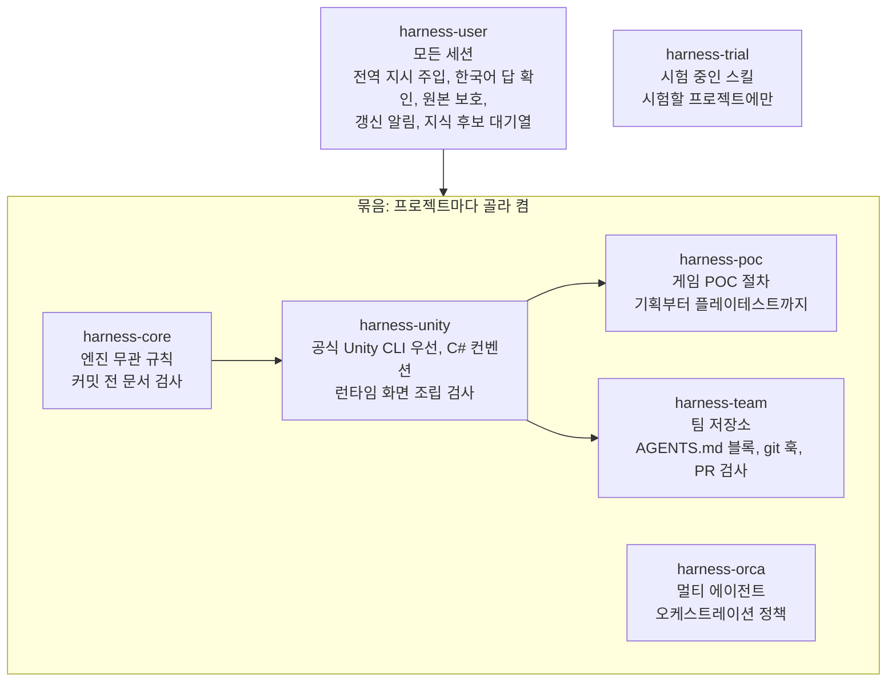
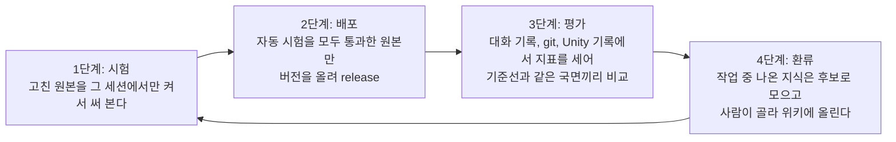

# harness

Claude Code와 Codex가 프로젝트에서 지킬 규칙, 스킬, 훅, 커밋 전 검사를 플러그인 묶음으로 만든 개인 AI 작업 하네스입니다. 프로젝트를 시작할 때 묶음을 켜기만 하면 같은 작업 방식이 바로 적용되고, 원본을 한 번 고치면 켜 둔 모든 프로젝트에 함께 반영됩니다.

지금은 플러그인 7개, 스킬 12개, 자동 시험 317개로 되어 있고, 이렇게 만들기까지 내린 설계 결정 182건을 기록해 두었습니다. 그중 하네스의 모양을 정한 결정은 [docs/decisions.md](docs/decisions.md)에 요약했습니다.

## 왜 만들었나

처음에는 AGENTS.md에 "끝내기 전에 확인 단계를 돌린다", "마감 절차를 따른다" 같은 규칙을 문장으로 적어 두고 에이전트에게 맡겼습니다. 그 방식으로 Unity POC 하나를 끝까지 만든 뒤 대화 기록을 직접 세어 보았는데, 결과가 예상과 달랐습니다. 에이전트는 보고에 확인과 마감 단계를 했다고 30번가량 적었지만, 실제로 그 도구를 부른 것은 한 번과 0번이었습니다. 반대로 실제로 문제를 잡아낸 것은 커밋 전 코드 검사, 확인 명령, 그리고 제가 직접 한 플레이테스트였습니다.

여기서 얻은 결론은 단순했습니다. **문장으로 적은 규칙은 지켜지지 않는다.** 그래서 반드시 지켜야 하는 것은 훅과 커밋 전 검사로 옮겨 도구가 강제하게 하고, 사람의 판단이 필요한 것만 짧은 규칙으로 남기기로 했습니다.

또 하나의 문제는 규칙이 프로젝트를 넘어가지 못한다는 점이었습니다. 프로젝트마다 규칙 파일을 복사해 넣다 보니 프로젝트마다 다른 시점의 규칙이 남아 제각각 낡았고, 한 프로젝트에서 배운 것이 다음 프로젝트로 이어지지 않았습니다. 그래서 규칙과 검사를 플러그인 안에 두고, 프로젝트는 플러그인을 켜기만 하는 구조로 바꿨습니다.

## 어떻게 생겼나

하네스는 세 층으로 나뉩니다. 모든 세션에 적용되는 **user 층**, 프로젝트 성격에 맞게 골라 켜는 **묶음 층**, 아직 효과가 입증되지 않은 스킬을 시험하는 **시험 층**입니다.



묶음은 모두 규칙, 컨벤션, 문서, 확인, 도구, 평가라는 같은 여섯 칸을 채웁니다. 그래서 다른 엔진이나 스택이 필요해지면 같은 칸을 채운 묶음 하나를 더하면 됩니다.

어떤 묶음을 쌓을지는 **프로필**로 고릅니다. 프로필은 묶음 목록과 문서 수준 두 가지로 정해집니다.

| 프로필 | 쌓는 묶음 | 문서 수준 | 언제 쓰나 |
|---|---|---|---|
| `personal` | core | standard | 엔진 없이 오래 가는 프로젝트 |
| `unity-game` | core + unity | standard | 오래 가는 개인 Unity 게임 |
| `unity-poc` | core + unity + poc | light | 짧게 끝낼 게임 POC |
| `unity-team` | core + unity + team | standard | 제가 PR 관리자인 팀 저장소 |

멀티 에이전트로 개발할 때만 어느 프로필 위에든 orca 묶음을 더합니다.

프로젝트 안에 실제로 들어가는 파일은 처음 한 번 만드는 문서 틀(AGENTS.md 머리, docs)과 커밋 전 검사를 잇는 `.githooks/` 정도입니다. 규칙은 세션이 시작될 때 훅이 플러그인에서 읽어 주입합니다. 다만 팀원은 제 플러그인을 깔지 않으므로, 팀 저장소에서는 팀원의 결과물에 닿아야 하는 규칙과 검사를 저장소 파일로 넣습니다.

## 어떻게 고쳐 나가나

하네스는 한 번 만들고 끝나지 않습니다. 프로젝트를 하나 끝낼 때마다 기록을 다시 재고, 그 결과로 하네스를 고칩니다.



1. **시험**: `claude --plugin-dir <묶음 폴더>`로 고친 원본을 그 세션에서만 켜서 써 봅니다. 새 스킬은 통과 기준을 먼저 정하고 `trial/`에서 시험합니다.
2. **배포**: `tests/run.mjs`가 모두 통과하면 원본의 지문을 남기고, `release.mjs`는 원본이 그 지문과 다르면 배포를 멈춥니다. 시험을 건너뛴 원본은 나가지 않습니다.
3. **평가**: `eval/run.py`가 대화 기록, Unity eval 기록, git에서 지표를 셉니다. 에이전트의 자기 보고는 근거로 쓰지 않습니다. "끝났다고 한 뒤 사람이 찾은 버그"처럼 판단이 필요한 항목은 후보만 뽑고 제가 직접 판정합니다.
4. **환류**: 에이전트가 다음 프로젝트에도 쓸 지식을 찾으면 보고 끝에 `wiki 후보: <한 줄>`을 붙이고, 훅이 이 줄을 PC의 대기열에 모읍니다. 저장소에는 쓰지 않으므로 팀 저장소에 흔적이 남지 않고, 위키에는 제가 고른 것만 올라갑니다.

기준선은 하네스 이전 방식으로 만든 POC의 마감 국면입니다. 하루 동안 도구를 쓴 4.8시간 중 30%가 확인에 쓰였고, 커밋 60개 중 fix가 13개였는데 그중 테스트를 함께 더한 커밋은 하나도 없었습니다.

하네스로 만든 첫 프로젝트는 이 기준선보다 나빠진 비율이 없었습니다. 대신 제가 가장 많이 고친 것이 게임 안 문구(15번 넘게)와 UI 겹침(10번 안팎)이었고, 한 세션이 27시간 이어지며 압축이 17번 일어났습니다. 이를 근거로 문구 규칙, UI 캡처 규칙, 새 세션 제안 규칙을 더했습니다([Q182](docs/decisions.md#q182-첫-프로젝트-기록-분석으로-규칙-셋을-더함)).

## 써 보기

Node.js, Python 3, git, Claude Code CLI가 필요합니다(Node 24, Python 3.13에서 시험했습니다). Unity 묶음을 쓰려면 Unity 공식 CLI도 필요합니다.

원래 이 하네스는 개인 지식 저장소 안의 `_harness/` 폴더에 들어 있고, 설치 스크립트는 이 폴더의 부모를 원본 저장소로 봅니다. 그래서 아무 폴더 아래에 `_harness`라는 이름으로 clone합니다.

```bash
git clone https://github.com/minsforgh/harness.git my-notes/_harness
```

먼저 시험이 도는지 확인합니다. 시험은 임시 폴더에서만 돌고 실제 설정은 건드리지 않습니다.

```bash
node my-notes/_harness/tests/run.mjs
```

PC 설정은 한 번만 하면 됩니다. 로컬 마켓플레이스 `harness`를 등록하고, harness-user를 user 범위로 설치하고, Codex 홈의 AGENTS.md에 전역 지시를 넣습니다. 여러 번 돌려도 결과는 같고, `--dry-run`으로 바뀔 것만 먼저 볼 수 있습니다.

```bash
node my-notes/_harness/setup.mjs --dry-run
```

```bash
node my-notes/_harness/setup.mjs
```

프로젝트에 적용할 때는 Claude 세션에서 "하네스 적용"이라고 말하면 harness-apply 스킬이 진행합니다. 직접 돌려도 됩니다. 적용은 커밋하지 않습니다.

```bash
node my-notes/_harness/apply.mjs <프로젝트 폴더> --profile personal --dry-run
```

```bash
node my-notes/_harness/apply.mjs <새 폴더> --new --profile unity-poc
```

`--new`는 폴더를 만들고 `git init`까지 한 뒤 적용합니다. unity 묶음이 들어가면 공식 `unity projects create`로 Unity 프로젝트도 만듭니다. 남이 관리하는 저장소라면 `--personal`을 붙여 제 PC에서만 플러그인을 켜고 공용 파일은 건드리지 않습니다.

원본을 고친 뒤에는 시험을 돌리고 release합니다. 설치본은 버전별 복사본이라 버전을 올려야 반영되고, 새 세션부터 적용됩니다.

```bash
node my-notes/_harness/tests/run.mjs
```

```bash
node my-notes/_harness/release.mjs harness-core
```

알림이 번거로우면 환경 변수로 끌 수 있습니다: `HARNESS_UPDATE_CHECK=0`(갱신 알림), `HARNESS_DOC_CHECK=0`(문서 검사 알림), `HARNESS_WIKI_CANDIDATES=0`(지식 후보 대기열).

## 폴더

| 경로 | 내용 |
|---|---|
| `user/` | harness-user: 전역 지시(`instructions.md`), 훅, 사용자 스킬 |
| `packs/<묶음>/` | `rules.md`(주입되는 규칙), `hooks/`, `skills/`, `git/checks/`(커밋 전 검사), `scaffold/`(처음 파일), `values.md`(프로젝트 값 표) |
| `trial/` | 시험 중인 스킬과 통과 기준 |
| `apply.mjs`, `setup.mjs`, `release.mjs` | 프로젝트 적용, PC 설정, 배포 |
| `tests/run.mjs` | 훅, 검사, 연결 파일, apply 시험(임시 저장소에서 실제 커밋까지) |
| `eval/` | 기록 기반 평가 스크립트 |

## 참고

- 문서와 주석은 한국어이고, 에이전트의 답도 한국어로 받도록 되어 있습니다(`user/instructions.md`).
- 주석에 나오는 `harness-design Q<번호>`는 비공개 설계 문서의 결정 번호입니다. 주요 결정은 [docs/decisions.md](docs/decisions.md)에 요약했습니다.
- 주석과 시험 스킬에 나오는 Arrowhead, MaxwellDemon, BreathForge, deskpet은 근거를 얻은 제 프로젝트 이름입니다.
- 평가의 기준선과 결과 파일은 대화 원문이 들어 있어 이 저장소에서 뺐습니다.
- Windows 11에서 만들고 시험했고, 다른 OS에서는 아직 돌려 보지 않았습니다.
